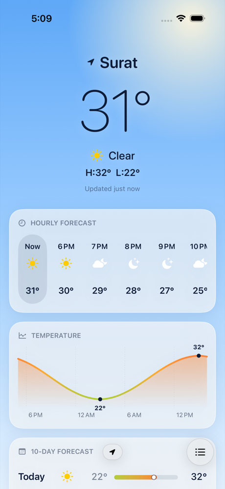
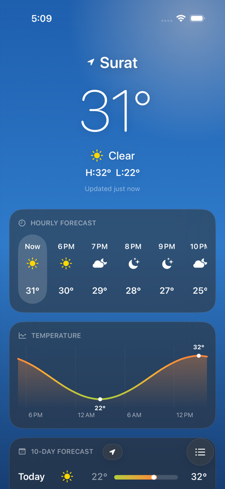
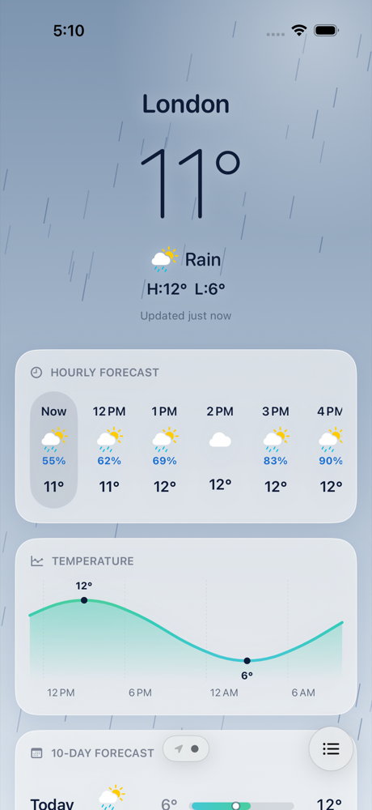
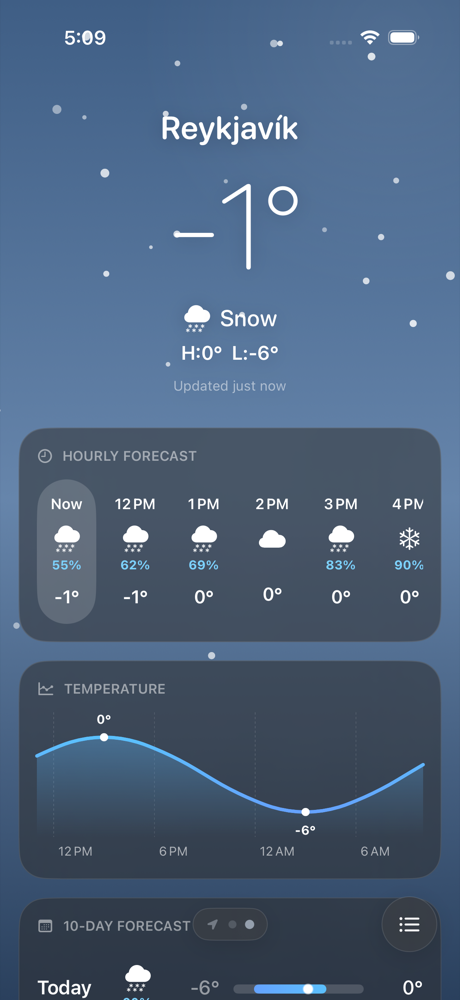
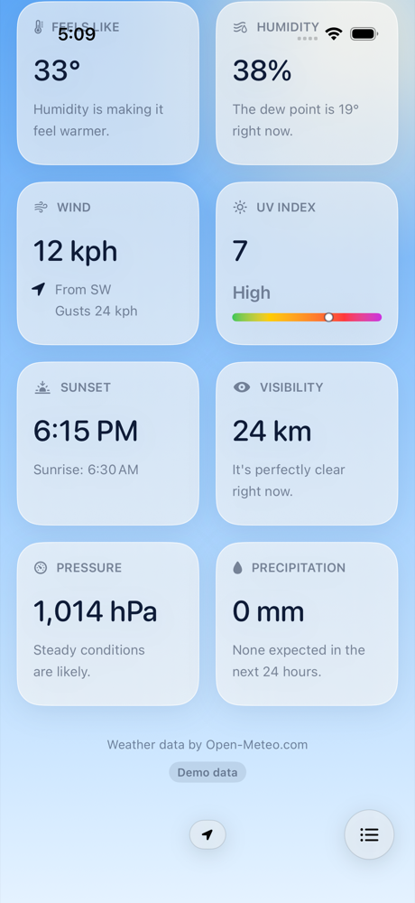
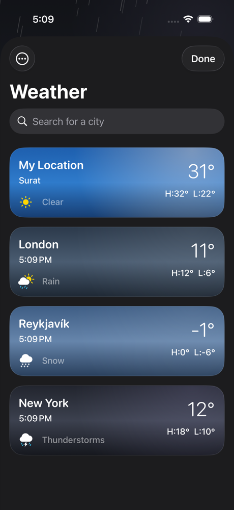

# Mausam

[](https://github.com/VasuChovatiya/Mausam/actions/workflows/ci.yml)
[](.swiftlint.yml)

A SwiftUI weather app (*mausam* is Hindi for weather). It shows the forecast for where you are and for
any city you search, works offline from its cache, and can run on either
[Apple WeatherKit](https://developer.apple.com/weatherkit/) or [Open-Meteo](https://open-meteo.com).

| Light | Dark |
| --- | --- |
|  |  |

## Features

- **Current location:** CoreLocation finds you and a reverse geocode names the city.
- **City search:** results update as you type (debounced). Saved cities can be reordered and deleted (SwiftData).
- **Swipe between places:** your location first, then saved cities, each with its own sky.
- **Forecast:**
  - current conditions with today's high and low
  - the next 24 hours, with chance of rain
  - a Swift Charts temperature curve
  - a 10-day forecast with temperature range bars
  - details: feels like, humidity, wind, UV index, sunrise and sunset, visibility, pressure, precipitation
- **Offline first:** the last forecast for every place is cached on disk. It shows instantly at launch.
  If a refresh fails, the old forecast stays on screen with a banner explaining why.
- **Light and dark mode:** each mode has its own palette for every condition, by day and by night.
  The app follows the system setting, or you can pick light or dark in the app.
- **Living sky:** animated rain, snow, stars and lightning, drawn in a single `Canvas`. They stay still
  when Reduce Motion is on.
- **Units:** °C or °F (or the system setting). Wind, visibility and pressure follow the region.
- **Accessibility:** Dynamic Type layouts, and VoiceOver summaries for the header, hours, days and chart.

## Screenshots

| Rain | Snow | Details | Places |
| --- | --- | --- | --- |
|  |  |  |  |

The screenshots use the built-in demo data (see [Testing](#testing)).

## Requirements

- Xcode 26 or later
- iOS 17 or later

## Setup

1. Clone the repo and open `Mausam.xcodeproj`. Xcode fetches the
   [NetworkingKit](https://github.com/VasuChovatiya/NetworkingKit) package automatically.
2. Run the **Mausam** scheme. It uses Open-Meteo, which needs no API key or account.

### Using WeatherKit

WeatherKit needs a paid Apple Developer account and an App ID with the WeatherKit capability and the
WeatherKit app service enabled.

```sh
cp Config/Local.example.xcconfig Config/Local.xcconfig
```

In `Config/Local.xcconfig`, set your team ID and bundle ID. The example file already sets
`WEATHER_PROVIDER = weatherkit` and points `CODE_SIGN_ENTITLEMENTS` at `Config/Mausam.entitlements`.
Git ignores `Local.xcconfig`. With WeatherKit, the app shows the Apple Weather mark and a link to its
legal page, as Apple's terms require.

## Architecture

MVVM with a repository layer, using Swift 6 strict concurrency.

```
Mausam/
├── App/           App entry point and dependency wiring (live, demo, previews)
├── Features/
│   ├── Forecast/      Forecast page and its cards (ForecastViewModel)
│   ├── Places/        Saved places and debounced city search (PlaceSearchViewModel)
│   └── Root/          Pager and floating page bar
├── Data/
│   ├── Models/        Place, WeatherReport, Condition
│   ├── Repository/    WeatherProvider protocol, ForecastRepository (provider + cache)
│   ├── OpenMeteo/     Endpoints, DTOs, provider, place search, mapper
│   ├── WeatherKit/    WeatherKit provider and mapper
│   ├── Location/      CoreLocation one-shot lookup with async/await
│   ├── Cache/         ForecastCache actor: JSON on disk, memory in front
│   ├── Persistence/   SwiftData SavedPlace
│   └── Demo/          Offline Open-Meteo responses served through a fake HTTP transport
└── Core/          Design system (sky themes, particles, cards, type, spacing) and formatting
```

- **Two providers, one model:** view models depend on `WeatherProvider`. `OpenMeteoWeatherProvider`
  and `WeatherKitProvider` both map into the same `WeatherReport`. It stores metric values, so the
  cache doesn't depend on the unit setting.
- **Networking:** [NetworkingKit](https://github.com/VasuChovatiya/NetworkingKit) provides `APIClient`,
  retries with backoff, and request logging with secrets redacted. The whole forecast screen is
  one Open-Meteo request.
- **Cache first:** `ForecastViewModel` shows the cached report, then refreshes it if it is older than
  15 minutes. Pull to refresh always fetches.
- **Time zones:** hours, days and sunrise are labelled in the place's own time zone, not the phone's.

## Testing

```sh
# Unit tests (Swift Testing): view models, mappers, cache, formatting, demo transport
xcodebuild test -project Mausam.xcodeproj -scheme Mausam \
  -destination 'platform=iOS Simulator,name=iPhone 17' -only-testing:MausamTests

# UI smoke tests (XCTest): offline demo data, no network or location prompt
xcodebuild test -project Mausam.xcodeproj -scheme Mausam \
  -destination 'platform=iOS Simulator,name=iPhone 17' -only-testing:MausamUITests/MausamUITests \
  -parallel-testing-enabled NO
```

The UI tests launch with `-UITestDemoData`. In that mode `DemoTransport` answers Open-Meteo-shaped
JSON for eight real cities, each with its own climate. The request, decoding and mapping code is the
same as in the live app.

`ScreenshotTests` regenerates the screenshots above in light and dark mode. It is skipped unless you
set `TEST_RUNNER_MAUSAM_CAPTURE=1`. Set `TEST_RUNNER_MAUSAM_CAPTURE_DIR` to a folder to save the PNGs there.

CI ([`.github/workflows/ci.yml`](.github/workflows/ci.yml)) runs SwiftLint and both test suites on
every push and pull request.

## Attribution

Weather data by [Open-Meteo.com](https://open-meteo.com) ([CC BY 4.0](https://open-meteo.com/en/license)),
or by Apple Weather when built for WeatherKit.

## License

MIT. See [LICENSE](LICENSE).
